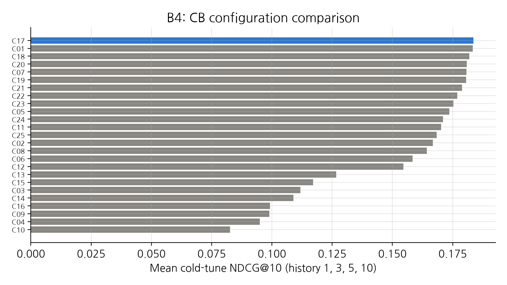
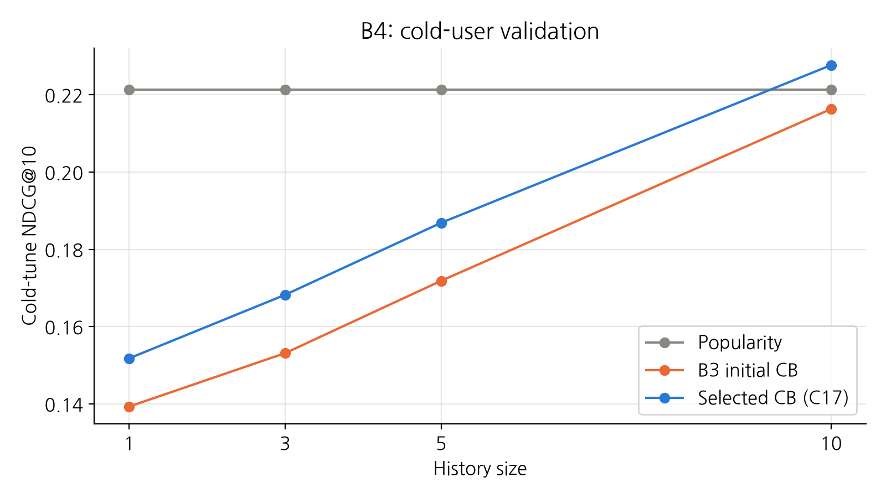
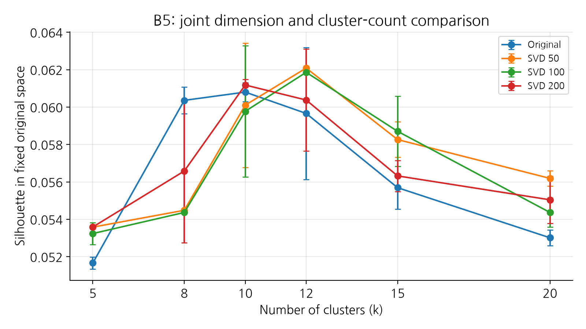

# 콘텐츠 기반 추천과 책 군집 (B1~B5)

## 먼저 실행할 것
레포 루트에서 uv sync --locked 후 uv run pytest를 실행합니다.
원본 데이터가 없으면 uv run python scripts/download_data.py를 실행합니다.

## 최종 모델 사용
```python
from bookrec.data import load_split, load_books
from bookrec.models.content_based.tuning import load_selected_content_based
from bookrec.models.content_based.clustering import load_selected_clusters, representative_books
from bookrec.evaluation import evaluate_warm, evaluate_cold

split = load_split()
model = load_selected_content_based().fit(split.train)
warm = evaluate_warm(model, split, on="val", n_users=1000, seed=42)
cold = evaluate_cold(model, split, on="tune")

features, clusters = load_selected_clusters()
representatives = representative_books(features, clusters, books=load_books(), diversify=True)
```

이 예제는 검증 평가입니다. test·cold_final은 설정 확정 이후 팀의 최종 평가 단계에서만 사용합니다.\
score(history)는 dense 점수표를 반환하므로 대량 독자를 한 번에 넣지 않습니다.\
공통 평가 함수는 500명씩 처리합니다. hybrid에서도 같은 크기의 배치를 권장합니다.\

## 파일과 실행 순서
| 순서 | 노트북 | 역할 |
| --- | --- | --- |
| 1 | B1_tag_cleaning.ipynb | 태그 규칙·제거 사례·통계 |
| 2 | B2_book_features.ipynb | 초기 특징 행렬·유사 도서 |
| 3 | B3_content_based.ipynb | 초기 CB·인기순 검증 |
| 4 | B4_configuration_compare.ipynb | 25개 설정 후보 비교·선택·독자별 bootstrap |
| 5 | B5_book_clustering.ipynb | 현재 최종 특징의 원본 공간 군집 기준선 |
| 6 | B5_clustering_improvement.ipynb | 차원/k/시드 비교·최종 판단·대표 책 |

1~3번은 원본 데이터에서 각각 실행할 수 있습니다. 5번은 4번의 선택 JSON을, 6번은 4·5번의 결과를 사용합니다. 전체를 재현하려면 표의 순서대로 실행합니다. 실행한 노트북에 따라 결과 CSV·JSON·PNG가 갱신됩니다.

| 설정 파일 | 용도 |
| --- | --- |
| B4_selected_config.json | **최종 추천기** |
| B5_selected_clustering.json | 원본 공간 비교 기준선 |
| B5_improvement_selected_config.json | **최종 군집**, adopted=False이면 명시된 원본 설정 유지 |

`ContentBasedConfig()`와 `build_book_features()`의 기본값은 초기 실험용입니다. 최종 모델은 위 예제의 로더로 불러옵니다.
각 단계의 설정과 결과는 [B1~B5 실험 문서](../../results/content_based)에 정리했습니다.

## 과정
A의 로더·분할·인기순·추천 후처리·공통 평가를 재사용했습니다.\
B1에서 책장·매체 태그를 제거하고 B2에서 희소 책 벡터를 만듭니다.\
B3는 좋아한 책의 평점 가중합으로 독자 취향을 구해 코사인 점수를 반환합니다.\
B4는 검증 데이터에서 최종 설정을 고르고 B5는 해당 책 벡터로 군집과 대표 책을 만듭니다.

태그 정제 범위와 책·독자 벡터의 가중치에 따른 차이를 보기 위해, B4에서는 책 특징을 태그로 구성하고 유사도는 코사인으로 고정했습니다. 제안서의 저자·출판 연대 결합과 Jaccard 비교는 이번 실험 범위에서 제외했습니다. 대표 저자는 B5에서 같은 저자의 책이 대표 목록에 반복되는 것을 줄이는 데 사용했습니다.

태그 정제 범위 2종, 책 가중치 3종, 독자 평점 가중치 2종을 조합한 12개와 TF-IDF의 로그 TF를 끈 4개를 먼저 평가했습니다. 상위 3개는 태그를 사용하기 위한 최소 등장 도서 수인 `min_df`를 1·5·10으로 바꿔 9개를 추가했습니다. 총 25개 후보를 같은 검증 데이터로 평가하고, 신규 독자 이력 1·3·5·10개 조건의 평균 NDCG@10으로 설정을 골랐습니다.

## 결과
선택한 추천기 C17은 `basic` 정제, `binary` 책 벡터, `min_df=1`, `positive` 독자 가중치를 사용합니다.
검증 NDCG@10은 신규 독자 이력 조건 평균 0.183624, 기존 독자 표본 0.050634입니다.
신규 독자 평균은 인기순보다 낮고, 1·2위 후보 간 차이는 불확실합니다.

신규 독자 검증에서 NDCG@10은 이력 1·3·5개 조건에서 인기순이 높았고, 10개 조건에서는 CB가 0.2277로 인기순 0.2213을 앞섰습니다. 읽고 싶다고 표시한 책의 적중을 보는 `to_read_hit@10`은 네 조건 모두 CB가 높았습니다.

`positive` 설정은 취향 벡터가 비면 학습 데이터의 인기순 점수로 대체합니다. 이력 1개 조건에서는 2,500명 중 616명(24.64%)이 대체됐으며, 보고한 NDCG@10에 이 독자들의 결과도 포함됩니다. `positive`와 `rating`의 점수 차이에는 평점 가중 방식과 인기순 대체의 효과가 함께 반영될 수 있습니다.

최종 군집은 원본 k=10, 원본 silhouette=0.061387.\
SVD 후보는 별도의 확인 표본에서 원본 방식보다 점수가 낮아 최종 설정으로 채택하지 않았습니다.

B5 군집은 신규 가입 시 취향 선택 화면에 제시할 대표 책을 고르는 데 쓰입니다. 군집별 주요 태그와 실제 대표 책 목록을 함께 보면 각 묶음의 성격을 해석할 수 있습니다. B3·B4의 추천 점수와 A5 평가 점수는 군집과 독립적으로 계산합니다.

### SVD
TruncatedSVD로 책의 태그 벡터를 50·100·200차원으로 줄였습니다.\
함께 나타나는 태그의 패턴을 적은 수의 축으로 요약해 군집을 만들려는 목적입니다. 축소된 축 하나가 특정 장르 하나를 뜻하지는 않습니다.

설정을 고르는 데 사용한 책 2,000권과, 그 책들이 포함되지 않은 확인용 책 2,000권을 따로 뽑았습니다.\
선택 표본에서는 SVD 50차원·k=12가 유망했지만, 확인 표본의 같은 원본 공간에서 계산한 silhouette는 원본 k=10이 약 0.063066, SVD 후보가 약 0.062573이었습니다.\
확인 표본에서는 개선이 유지되지 않았으므로, 미리 정한 채택 조건에 따라 SVD 후보를 기각하고 원본 k=10을 유지했습니다.\

여기서 ‘겹치지 않는다’는 두 평가 표본의 책 ID가 서로 다르다는 뜻입니다. 군집 학습 자체는 전체 카탈로그를 사용했으므로 독립적인 테스트셋 평가를 뜻하지 않습니다.\
또한 축소 공간의 silhouette와 원본 공간의 silhouette는 거리를 계산하는 공간이 달라 직접 비교하지 않습니다. 후보 간 개선 판단에는 같은 원본 공간의 점수를 사용했습니다.\
대표 책은 저자·명시적 시리즈 중복을 제한해 군집별 5권을 선택했습니다.

## 결론
CB 추천 성능은 `val`과 `cold_tune`에서 측정했습니다. B5에서는 카탈로그 내부의 책 표본으로 군집을 평가했으며, 대표 책이 실제 가입 화면에서 취향 선택에 도움이 되는지는 사용자 확인이 필요합니다.

## 이미지




## 2분 발표 대본
저희는 평점 이력이 적은 신규 독자에게도 추천할 수 있도록 책 태그 기반 추천기를 만들었습니다.\
먼저 읽기 상태나 소유 여부 같은 태그를 정리하고, 책을 태그 벡터로 표현했습니다.\
독자가 4점이나 5점을 준 책의 특징을 합쳐 취향 벡터를 만들고 비슷한 책을 추천합니다.\
취향 벡터를 만들 수 없으면 학습 데이터의 인기순 추천을 사용합니다.

설정은 같은 검증 데이터에서 25개 후보를 비교했습니다.\
현재는 basic 정제와 binary 벡터, min_df=1을 선택했습니다.\
NDCG@10 기준으로 기존 독자 검증에서는 CB가 앞섰습니다. 신규 독자에서는 이력 1·3·5개에서 인기순이, 10개에서 CB가 앞섰습니다.\
읽고 싶다고 표시한 책의 적중은 네 조건 모두 CB가 높았습니다.\
이력 한 개에서는 2,500명 중 616명, 약 25%가 인기순으로 대체됐고, 이 결과도 검증 점수에 포함했습니다.

책 군집에서는 차원 축소와 군집 수, 초기화 시드를 함께 비교했습니다.\
선택 표본에서 좋은 SVD 후보가 나왔지만 별도 표본에서는 개선이 유지되지 않아 원본 k=10을 유지했습니다.\
마지막으로 군집별 대표 책 5권을 고르되 같은 저자와 명시적 시리즈가 반복되지 않도록 했습니다.\
향후에는 최종 평가와 실제 사용자의 대표 책 선택 경험을 확인해야 합니다.\

## 어려웠던 점과 해결
- **태그 정제의 범위:** 처음에는 정확한 이름 목록으로 필터링했지만, 검토 과정에서 on-kindle·books-owned 같은 변형이 남아 있는 것을 확인했습니다. 명백한 상태·매체 태그의 패턴을 추가하되 명명된 추천 목록은 보존했습니다. 정제 규칙이 바뀌면 특징 행렬과 추천·군집 결과도 달라지므로 후속 실험을 모두 다시 실행했습니다.
- **테스트가 놓친 입력 오류:** 기존 테스트가 통과해도 문자열 count의 중복 합산이나 소수 count의 로그 TF 처리에는 문제가 있었습니다. 숫자로 변환한 값을 실제 합산에 사용하고, 횟수라는 의미에 맞게 유한한 비음수 정수만 허용하도록 수정했습니다. 같은 문제가 다시 발생하지 않도록 회귀 테스트도 추가했습니다.
- **군집 개선의 공정한 비교:** SVD 이후의 공간에서는 silhouette가 높아져도 원본 방식보다 나아졌다고 단정할 수 없었습니다. 같은 원본 공간과 같은 책 표본에서 비교하고, 여러 초기화 시드와 별도 확인 표본까지 점검했습니다. 확인 표본에서 개선이 유지되지 않은 후보는 채택하지 않았습니다.
- **공통 그래프 저장과 재현성:** B4에서 직접 저장하던 코드를 공용 save()로 통일했습니다. plot_style.py의 parents[2]가 레포지토리 루트라는 점도 다시 확인했습니다. 초기 실험 기본값과 최종 선택 설정이 다른 문제는 선택 JSON을 읽는 공식 로더와 실행 순서 안내로 구분했습니다.

## 개인별 배운 점
- 공통 로더·분할·평가 함수를 사용하면 구현을 중복하지 않고 팀원의 모델을 같은 조건에서 비교할 수 있다는 점을 배웠습니다.
- 단위 테스트는 입력 처리와 계산을 확인하고, 추천 성능은 같은 검증 데이터에서 기준선과 비교해야 한다는 차이를 이해했습니다.
- 표현 공간을 바꿨을 때는 동일한 거리 기준과 책 표본에서 비교해야 점수 차이를 해석할 수 있었습니다.
- 최종 설정 파일과 노트북 실행 순서를 함께 공유해야 다른 팀원도 같은 결과를 재현할 수 있다는 점을 배웠습니다.

## 참고한 외부 코드·자료 (출처)
- [Goodbooks-10k 데이터 출처](../../README.md#데이터-출처)
- scikit-learn 문서 [`TfidfTransformer`](https://scikit-learn.org/stable/modules/generated/sklearn.feature_extraction.text.TfidfTransformer.html), [`normalize`](https://scikit-learn.org/stable/modules/generated/sklearn.preprocessing.normalize.html), [`KMeans`](https://scikit-learn.org/stable/modules/generated/sklearn.cluster.KMeans.html), [`TruncatedSVD`](https://scikit-learn.org/stable/modules/generated/sklearn.decomposition.TruncatedSVD.html), [`silhouette_samples`](https://scikit-learn.org/stable/modules/generated/sklearn.metrics.silhouette_samples.html)
- 팀 공통 data·models/base·popularity·evaluation·plot_style 코드.
- 각 단계 노트북과 results/content_based의 대응 설명 문서.
