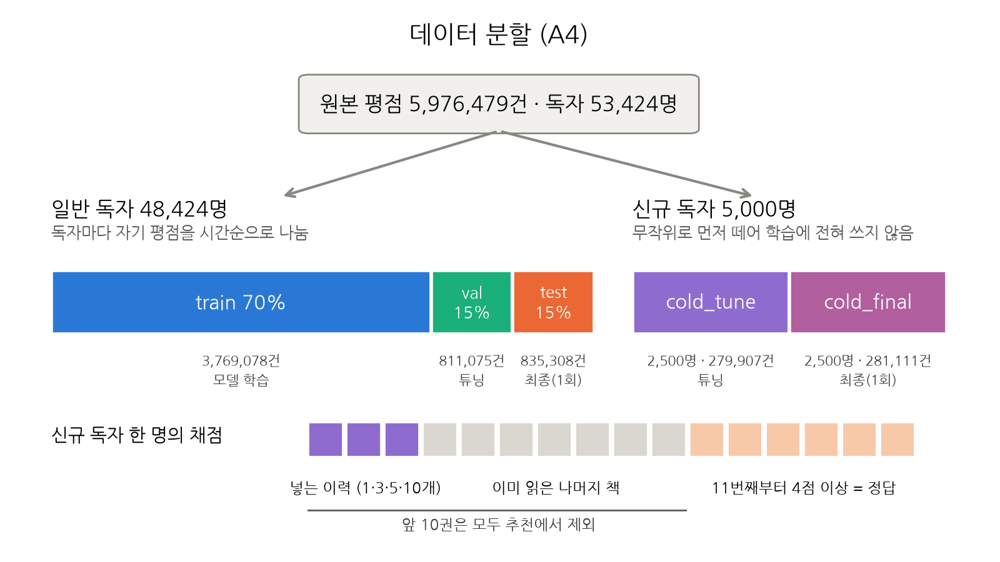
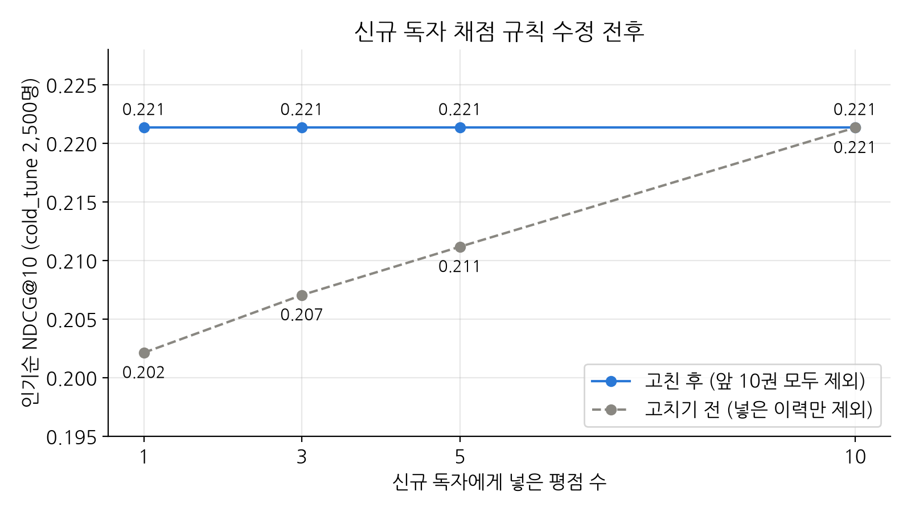

# 데이터·평가 (A1~A7)

모든 단계에서 공통으로 쓰는 레포 구조, 모델 인터페이스, 데이터 전처리, 데이터 분할, 평가 함수, 기준선을 맡았습니다. 모든 모델이 같은 데이터로 학습하고 같은 규칙으로 채점되도록 하는 바탕입니다. 전체 흐름은 [`docs/pipeline.md`](../pipeline.md)에 있습니다.

## 주요 의사결정 요약

| 항목       | 처음                               | 문제                                                                                        | 해결                                                                                                 |
| -------- | -------------------------------- | ----------------------------------------------------------------------------------------- | -------------------------------------------------------------------------------------------------- |
| 분할 비율    | 독자마다 평점을 80/10/10으로 나눴습니다.       | 독자당 정답이 중앙값 8권뿐이었고, 정답이 없어 채점에서 빠지는 독자가 364명이었습니다. 추천 10권을 다 맞혀도 P@10이 0.756을 넘을 수 없었습니다. | 70/15/15로 바꿨습니다. 정답은 12권, 빠지는 독자는 170명, P@10 최대치는 0.899가 됐고, bias RMSE는 0.8645 → 0.8692로 거의 같았습니다. |
| 신규 독자 수  | 1,000명(튜닝 500 / 최종 500)으로 정했습니다. | 근거 없이 정한 초기값이었고, 500명으로 재면 평균이 ±0.019만큼 흔들렸습니다.                                           | 5,000명(튜닝 2,500 / 최종 2,500)으로 늘렸습니다. 흔들림은 ±0.009로 줄었고, bias RMSE는 0.8692 → 0.8688로 학습 손해가 없었습니다.   |
| 프로젝트 목표  | 제안서의 Goal 1·2·3을 나란히 두었습니다.      | Goal 3(to\_read)은 다른 둘과 축이 달라, 신규 독자의 to\_read 적중은 잴 수 없었습니다.                             | 목표 2개(신규·기존 독자) × 평가 기준 3개(좋아한 책·읽고 싶은 책·별점)로 나눠 두 집단 모두에 적용했습니다.                                  |
| 평가 인원    | 기존 독자 중 무작위 5,000명만 채점했습니다.      | 같은 인기순인데 표본(0.0280)과 전원(0.0268)의 점수가 달랐습니다.                                               | 전원 채점을 기본으로 바꿨습니다. 인기순 기준 약 12초라 메모리 부담이 없었습니다.                                                    |
| 신규 독자 채점 | 넣은 이력에 있는 책만 추천에서 뺐습니다.          | 이미 읽은 2\~10번째 책이 추천되면 틀림으로 세졌습니다.                                                         | 앞 10권을 모두 추천에서 빼도록 고쳤습니다. 인기순 점수가 평점 수와 상관없이 같아졌습니다.                                               |

## 과정

### 1. 레포와 공통 인터페이스 (A1, A2)

| 폴더                                             | 내용                                                                                                         |
| ---------------------------------------------- | ---------------------------------------------------------------------------------------------------------- |
| `src/bookrec/data/`                            | 원본 읽기·전처리(A3), 데이터 분할(A4), 태그 정제(B1)                                                                       |
| `src/bookrec/models/`                          | 공통 인터페이스 `base.py`, 기준선 `baselines/`, CB `content_based/`, MF `collaborative_filtering/`, hybrid `hybrid/` |
| `src/bookrec/evaluation/`                      | 공통 평가 함수(A5)                                                                                               |
| `scripts/`, `notebooks/`, `results/`, `tests/` | 실행 스크립트, 실험 노트북, 결과 CSV, 테스트                                                                               |

**모델이 독자 ID 대신 평점 이력을 받게 함**

1. **문제:** 신규 독자는 학습에 없던 사람이라, 독자 ID만 받는 모델은 그 사람에게 추천할 수 없습니다. 기존 독자와 신규 독자를 다른 함수로 채점하면 두 결과를 같은 기준으로 볼 수도 없습니다.
2. **해결:** 모든 모델이 `score(이력)`으로 평점 이력 표를 받게 했습니다. 이력을 어떻게 쓸지는 모델이 정하고, 기존 독자와 신규 독자를 같은 함수로 추천받습니다.

**상위 10권 고르기를 공용 코드로 둠**

1. **문제:** 모델마다 이미 읽은 책을 빼는 방식이나 동점 처리가 다르면, 점수 차이가 모델 때문인지 고르는 방식 때문인지 알 수 없습니다.
2. **해결:** 모델은 점수표만 만들고, 이미 읽은 책을 빼고 상위 10권을 고르는 `recommend`는 공용 코드 하나로 처리했습니다.

### 2. 전처리 (A3)

| 파일·컬럼                             | 처리                                        | 근거                                                                                                                                                                  |
| --------------------------------- | ----------------------------------------- | ------------------------------------------------------------------------------------------------------------------------------------------------------------------- |
| `ratings.csv` 전체                  | 바꾸지 않음                                    | 결측 0건, (독자, 책) 중복 0건, 별점은 모두 1\~5 정수라 고칠 값이 없습니다                                                                                                                    |
| `ratings.csv` 행 순서                | 정렬하지 않고 파일 순서를 그대로 둠                      | 시각 컬럼이 없고 원본 설명에 시간순으로 저장됐다고 되어 있어, 행 순서가 유일한 시간 정보입니다. 분할(A4)에서 이 순서로 과거와 미래를 나눕니다                                                                                 |
| `to_read.csv` 전체                  | 바꾸지 않음                                    | 결측 0건, 중복 0건입니다                                                                                                                                                     |
| `books.goodreads_book_id`         | 뺌                                         | 책 태그와 연결할 때만 필요한 ID입니다. 연결한 뒤에는 모든 데이터가 `book_id`를 쓰므로, 남겨 두면 두 ID가 섞일 수 있습니다                                                                                       |
| `books.title`                     | 앞뒤 공백 제거                                  | 38권의 제목에 앞뒤 공백이 있어 같은 제목이 다르게 보일 수 있었습니다                                                                                                                            |
| `books.authors`                   | 쉼표로 나눠 이름 목록으로 바꾸고, 이름 안의 연속 공백을 한 칸으로 줄임 | 전체 중 2,079권이 authors 컬럼에 여러 명(삽화가·번역가 포함, 예: "J.K. Rowling, Mary GrandPré")을 한 문자열로 담고 있었습니다. 168권은 "Betty Smith"처럼 이름 안에 공백이 두 칸 이상이라, 그대로 두면 같은 저자가 다른 사람으로 세어집니다 |
| `books.main_author` (추가)          | 저자 목록의 첫 사람                               | 원저자가 앞에, 삽화가·번역가가 뒤에 오는 형태라 첫 이름이 대표 저자입니다. 대표 책을 고를 때 같은 저자가 반복되지 않게 하는 데 씁니다                                                                                      |
| `books.original_publication_year` | 바꾸지 않음                                    | 결측 21권, 음수(기원전) 31권이 있지만 기원전 작품의 실제 연도라 지우지 않습니다. 연대를 어떻게 묶을지는 쓰는 쪽에서 정합니다                                                                                          |
| `books.language_code`             | 바꾸지 않음                                    | 1,084권이 비어 있지만 채울 근거가 없습니다                                                                                                                                          |
| `book_tags.goodreads_book_id`     | `books.csv`로 `book_id`로 바꿈                | 평점·to\_read는 `book_id`를 써서 같은 번호로 맞춰야 합니다. 1만 권 모두 바꿀 수 있었습니다                                                                                                       |
| `book_tags.tag_id`                | `tags.csv`와 연결해 태그 이름을 붙임                 | 태그 번호만으로는 `to-read` 같은 책장 태그를 골라낼 수 없어, 이름이 있어야 태그 정제(B1)를 할 수 있습니다                                                                                                 |
| `book_tags.count`가 음수인 행          | 6행 삭제                                     | `count`는 그 태그를 단 독자 수라 음수일 수 없기 때문에 삭제하였습니다.                                                                                                                        |
| `book_tags`의 같은 (책, 태그) 중복        | 8쌍은 큰 `count` 하나만 남김                      | 책 × 태그 표의 한 칸에는 값이 하나만 들어가야 합니다. 부풀려지지 않도록 큰 값 하나만 대표로 남기고 나머지 중복 쌍은 삭제하였습니다.                                                                                       |

#### 구현 결정사항

- 정리한 파일을 따로 저장하지 않고, 불러올 때마다 위 처리를 적용합니다(1초 안팎). 원본 하나만 두면 팀원마다 다른 버전의 정리 파일을 쓰는 일이 없습니다.
- 책 정보와 태그는 한 표로 합치지 않았습니다. 합치면 83MB가 811MB로 커져서, 필요한 쪽에서 `book_id`로 연결해 씁니다.

### 3. 데이터 분할 (A4, A7)

**분할 비율: 80/10/10 → 70/15/15**

1. **처음:** 독자마다 평점을 시간순 80/10/10으로 나눴습니다.
2. **문제:** test가 10%뿐이라 독자 한 명의 정답(4점 이상)이 중앙값 8권에 그쳤고, 정답이 하나도 없어 채점에서 빠지는 독자가 364명이었습니다(일반 독자 5,000명 표본). 추천 10권을 모두 맞혀도 P@10이 평균 0.756을 넘을 수 없었습니다.
3. **해결:** 70/15/15로 바꿨습니다. 정답은 중앙값 12권, 채점에서 빠지는 독자는 170명으로 줄었고, P@10의 최대치는 0.899가 됐습니다. 학습 데이터는 줄었지만 bias 기준선 RMSE는 0.8645 → 0.8692로 거의 같았습니다.

**신규 독자 수: 1,000명 → 5,000명**

1. **처음:** 신규 독자 실험용으로 1,000명을 떼어 튜닝 500명, 최종 500명으로 나누려 했습니다.
2. **문제:** 1,000명은 근거 없이 정한 숫자였습니다. 재 보니 500명으로 잰 인기순 P@10은 평균이 ±0.019만큼 흔들려서, 모델끼리 비교하기에는 불안정했습니다.
3. **해결:** 5,000명(튜닝 2,500 / 최종 2,500)으로 늘렸습니다. 흔들림이 ±0.009로 줄었고, 학습에서 빠지는 독자가 늘어도 bias RMSE는 0.8692 → 0.8688로 학습 손해가 없었습니다.

**일반 독자를 사람마다 시간순으로 나눔**

1. **문제:** 평점을 무작위로 섞어 나누면 한 독자의 미래 평점이 학습에 들어가 과거를 맞히는 셈이 되고, 독자 단위로 나누면 일부 독자가 학습에 아예 없게 됩니다.
2. **해결:** 독자마다 자기 평점을 시간순으로 나눴습니다. 모든 일반 독자가 train에 있어 기존 독자에게 추천할 수 있고, 과거 평점으로 미래를 맞히는 상황이 됩니다.

### 4. 공통 평가 (A5)

목표를 **누구에게**(신규·기존 독자)와 **무엇을 정답으로**(평가 기준)로 나눠 채점합니다.

| 목표 ↓ / 평가 기준 →              | 좋아한 책 (4점 이상)       | 읽고 싶은 책 (to\_read) | 실제 별점         |
| --------------------------- | ------------------- | ------------------ | ------------- |
| Goal 1 신규 독자 (평점 1·3·5·10개) | P@10, R@10, NDCG@10 | to\_read 적중        | 재지 않음         |
| Goal 2 기존 독자                | P@10, R@10, NDCG@10 | to\_read 적중        | RMSE (별점 모델만) |

**작업 중 재정의한 프로젝트 목표: Goal 3를 평가 기준으로**

1. **처음:** 제안서에는 Goal 1 신규 독자, Goal 2 기존 독자, Goal 3 읽고 싶은 책(to_read)이 나란히 있었습니다.
2. **문제:** Goal 1·2는 "누구에게"이고 Goal 3는 "무엇을 정답으로"라서 서로 다른 축이었습니다. 그대로 두면 to_read를 기존 독자에게만 재게 되어 신규 독자에게 관심 있는 책을 추천하는지는 알 수 없었습니다.
3. **해결:** 목표는 신규·기존 독자 두 개로 두고, 좋아한 책·읽고 싶은 책·실제 별점을 평가 기준으로 나눠 위 표처럼 두 집단 모두에 적용했습니다.

**좋아한 책 = 4점 이상**

1. **문제:** Precision·Recall은 추천이 맞았는지 틀렸는지로 세야 해서, 별점을 "좋아함 / 아님"으로 나누는 기준이 필요했습니다.
2. **해결:** 1~5점 척도에서 4점 이상을 정답으로 보는 방식이 추천 평가 연구에서 쓰여 온 기준이라(Bellogín 외, 2011), 이 기준을 우선 채택했습니다. 우리 데이터로 기준별 비중도 확인했습니다.

| 기준             | 정답이 되는 평점 비율 | 뜻                                               |
| -------------- | ------------ | ----------------------------------------------- |
| 3점 이상          | 91.9%        | 읽은 책이 거의 다 정답이 되어, "좋아할 책"보다 "읽을 책 맞히기"에 가까워집니다 |
| **4점 이상 (채택)** | **69.0%**    | 좋아한 책                                           |
| 5점만            | 33.2%        | 정답이 적어 점수가 낮아지고, 정답이 없어 빠지는 독자가 늘어납니다           |

- 같은 논문은 기준값을 바꾸면 점수 크기는 달라져도 모델 간 순위는 유지된다고 보고했습니다. 그래서 3점·5점 결과는 필요할 때 참고로만 보고, 결과를 보고 주 기준을 바꾸지 않습니다.

**최종 채점의 이력에 val을 포함**

1. **문제:** test는 val보다 나중 구간이라, test 시점의 독자는 val의 책을 이미 읽었습니다. train만 이력으로 넣으면 val의 책이 다시 추천되어 틀림으로 세지고, 그 독자에 대한 최신 정보도 버리게 됩니다.
2. **해결:** 튜닝은 이력 train → 정답 val, 최종은 이력 train + val → 정답 test로 채점하도록 구현하였습니다.

**신규 독자의 정답을 11번째 평점부터로 고정**

1. **문제:** 넣는 이력이 1·3·5·10개로 달라질 때 정답 구간도 따라 바뀌면, 점수 차이가 모델이 나아져서인지 정답이 바뀌어서인지 알 수 없습니다.
2. **해결:** 네 경우 모두 11번째 평점부터 4점 이상을 정답으로 고정했습니다.

**to_read 정답에서 이미 읽은 책을 뺌**

1. **문제:** to_read에 넣어 두고 나중에 실제로 읽어 평점까지 준 책이 2,200쌍 있습니다. 이 책들은 이미 읽은 책이라 추천에서 빠지는데, 정답에 남아 있으면 맞힐 수 없는 정답이 됩니다.
2. **해결:** to_read 정답에서 이미 읽은 책을 뺐습니다.

**정답이 없는 독자는 그 지표에서만 제외**

1. **문제:** 정답이 하나도 없는 독자는 Recall과 NDCG를 계산할 수 없습니다(0으로 나누게 됩니다).
2. **해결:** 지표를 독자마다 계산한 뒤 평균을 내고, 정답이 없는 독자는 그 지표의 평균에서만 뺍니다. 학습 데이터에는 그대로 남습니다.

**평가 인원: 표본 5,000명 → 전원**

1. **처음:** 기존 독자는 계산량을 줄이려고 무작위 5,000명만 채점하려 했습니다.
2. **문제:** 같은 인기순인데 표본으로 잰 test P@10(0.0280)과 전원으로 잰 값(0.0268)이 달라, 표본에 따라 숫자가 바뀌었습니다.
3. **해결:** 기본을 전원 채점으로 바꿨습니다. 인기순 기준 전원 채점이 약 12초라 부담이 없었고, 빠른 비교가 필요하면 표본 수를 넘겨 줄일 수 있게 했습니다.

**메모리: 500명씩 나눠 채점**

1. **문제:** 기존 독자 4.8만 명의 점수표(독자 수 × 책 1만 권)를 한 번에 만들면 약 4GB이고, 계산 중 복사본까지 생기면 약 8GB가 필요합니다.
2. **해결:** 독자를 500명씩 나눠 추천받고, 상위 10권만 남긴 뒤 점수표는 바로 버리도록 했습니다. 한 번에 쓰는 메모리는 약 40MB입니다.

### 5. 기준선 (A6)

| 기준선           | 방법                           | 쓰는 지표 |
| ------------- | ---------------------------- | ----- |
| 인기순           | train에서 평점이 많은 책 순           | 순위 지표 |
| Goodreads 평점순 | `books.csv`의 사이트 평균 별점 순     | 순위 지표 |
| bias          | 전체 평균 + 독자 성향 + 책 성향으로 별점 예측 | RMSE  |

## 결과

### 기준선 점수 (튜닝 구간)

| 기준선           | Goal 2 NDCG@10 (val) | Goal 2 to\_read 적중 | Goal 1 NDCG@10 (cold\_tune, 평점 수와 무관) | Goal 1 to\_read 적중 |
| ------------- | -------------------- | ------------------ | ------------------------------------- | ------------------ |
| 인기순           | 0.0364               | 0.0286             | 0.2213                                | 0.0201             |
| Goodreads 평점순 | 0.0020               | 0.0006             | 0.0089                                | 0.0006             |

| 기준선  | val RMSE |
| ---- | -------- |
| bias | 0.8616   |

- 인기순은 단순하지만 강한 기준선입니다. 다른 모델이 이 점수를 넘어야 개인화가 의미 있다고 볼 수 있습니다.
- Goodreads 평점순은 인기순보다 훨씬 낮습니다. 평균 별점은 "그 책을 읽은 사람이 얼마나 만족했나"를 나타내고, "앞으로 얼마나 많은 사람이 읽을까"와는 다른 정보입니다. 이 데이터에서 독자가 다음에 읽고 좋아할 책을 맞히는 데는 만족도보다 인기(읽는 사람 수)가 훨씬 강한 신호라는 뜻입니다.
- `average_rating`은 우리 평점 파일이 아니라 Goodreads 사이트 전체 독자의 집계값이라, 외부 정보를 쓴 기준선입니다.

### 신규 독자 채점 규칙 수정 (Goal 1)

1. **처음:** 신규 독자에게 넣은 이력(앞 1·3·5개)에 있는 책만 추천에서 뺐습니다.
2. **문제:** 이력을 1개만 넣어도 그 독자가 2~10번째로 읽은 책은 이미 읽은 책입니다. 이 책들이 추천되면 정답 구간(11번째부터)에 없어서 틀림으로 세졌습니다. 이력을 전혀 보지 않는 인기순 점수가 평점 수에 따라 오르는 것을 보고 이 문제를 찾았습니다.
3. **해결:** 넣은 이력 수와 상관없이 앞 10권을 모두 추천에서 빼도록 고쳤습니다. 인기순 점수가 평점 수와 상관없이 같아졌습니다.

| 인기순 NDCG@10 (cold\_tune) | 평점 1개 | 3개    | 5개    | 10개   |
| ------------------------ | ----- | ----- | ----- | ----- |
| 고치기 전 (넣은 이력만 제외)        | 0.202 | 0.207 | 0.211 | 0.221 |
| 고친 후 (앞 10권 모두 제외)       | 0.221 | 0.221 | 0.221 | 0.221 |

- 기존 독자 채점은 이미 읽은 책(train 또는 train + val)을 모두 이력으로 넣어 빼므로 이 문제가 없었습니다.

## 결론

같은 데이터·같은 규칙으로 채점해서 네 가지 방법을 한 표에서 비교할 수 있었습니다(튜닝 구간).

| 대상                         | 인기순   | CB    | MF    |
| -------------------------- | ----- | ----- | ----- |
| 기존 독자 NDCG@10 (val 5,000명) | 0.038 | 0.052 | 0.072 |
| 신규 독자 NDCG@10, 평점 1개       | 0.221 | 0.152 | 0.253 |
| 신규 독자 NDCG@10, 평점 10개      | 0.221 | 0.228 | 0.296 |
| 신규 독자 to\_read 적중, 평점 1개   | 0.020 | 0.024 | 0.019 |

| 대상             | bias  | MF (별점 예측용) |
| -------------- | ----- | ----------- |
| 기존 독자 val RMSE | 0.862 | 0.839       |

- **인기순은 넘기 어려운 기준선이었습니다.** 신규 독자에게 CB는 평점 1~5개에서 인기순보다 낮았고 10개에서야 넘었습니다. MF는 평점 1개부터 인기순을 넘었습니다.
- **정답에 따라 강한 모델이 달랐습니다.** 신규 독자의 좋아한 책은 MF가, 읽고 싶은 책은 CB가 가장 잘 맞혔습니다. 두 점수를 섞는 hybrid가 필요한 근거입니다.
- **만족도보다 인기가 강한 신호였습니다.** Goodreads 평점순은 거의 맞히지 못했고, 인기순은 강했습니다.
- **Goal 1과 Goal 2의 숫자는 서로 비교하지 않습니다.** 독자당 정답 수(중앙값)가 69권과 12권으로 달라, 같은 인기순도 P@10이 0.207과 0.033으로 나옵니다.
- 출처: 인기순·Goodreads 평점순·bias는 `results/evaluation/baselines_*.csv`, CB는 `results/content_based/B4_validation_scores.csv`, MF는 `docs/parts/mf.md`의 비교표입니다. 최종 구간(test·cold_final) 비교는 결과 집계(D4)에서 정리합니다.

## 이미지

- 원본 평점을 신규 독자 5,000명(학습에 전혀 쓰지 않음)과 일반 독자 48,424명으로 먼저 나누고, 일반 독자는 사람마다 시간순 70/15/15로 나눈 구조입니다. 아래 줄은 신규 독자 한 명을 어떻게 채점하는지 보여 줍니다.
- 다시 만들기: `uv run python scripts/plot_data_split.py`

- 인기순은 독자의 이력을 보지 않아 평점을 몇 개 넣든 점수가 같아야 합니다. 고치기 전(회색 점선)에는 평점을 많이 넣을수록 점수가 올랐는데, 이는 모델이 나아져서가 아니라 이미 읽은 책이 틀림으로 세지는 채점 규칙 때문이었습니다. 고친 후(파란 선)에는 평점 수와 상관없이 0.221로 같아졌습니다.
- 그래서 이제 신규 독자 그래프에서 평점이 늘수록 점수가 오르면, 그 차이는 채점 규칙이 아니라 모델이 실제로 나아진 효과입니다.
- 다시 만들기: `uv run python scripts/plot_middle_book_fix.py` (결과 표 `results/evaluation/A5_middle_book_fix.csv`)

## 2분 발표 대본

데이터·평가 파트는 모든 단계에서 공통으로 쓰는 데이터 전처리, 데이터 분할, 모델 인터페이스, 평가 함수, 그리고 기준선 구현을 담당했습니다.  
먼저 신규 독자 상황을 만들기 위해 독자 5,000명을 무작위로 떼어 학습에서 완전히 뺐습니다. 나머지 독자는 각자의 평점을 시간순으로 train 70%, validation 15%, test 15%로 나눴습니다. 처음에는 80 대 10 대 10으로 나눴지만, test에 남는 정답이 독자당 8권뿐이라 비율을 80%, 15%, 15%로 바꿨습니다.  
평가는 누구에게 추천하는지와 무엇을 정답으로 보는지를 나눠 설계했습니다. 신규 독자와 기존 독자 각각에 대해 4점 이상 준 책과 읽고 싶다고 표시한 책을 얼마나 맞히는지 보고, 별점을 예측하는 모델은 오차도 쟀습니다. 신규 독자에게는 평점을 1, 3, 5, 10개만 넣어, 각 모델이 평점이 늘수록 얼마나 나아지는지 비교했습니다.

이 과정에서 신규 독자 채점 규칙의 빈틈을 하나 찾았습니다. 독자의 이력을 전혀 보지 않는 인기순은 평점을 몇 개 넣든 점수가 같아야 하는데, 평점을 많이 넣을수록 점수가 올랐습니다. 독자가 이미 읽은 책이 추천되면 틀림으로 세지는 것이 원인이었고, 앞 10권을 모두 추천에서 빼도록 고치자 인기순 점수가 평점 수와 상관없이 같아졌습니다.  
기준선으로는 인기순, Goodreads 평점순, 별점 예측용 bias 모델을 두었습니다. 인기순이 생각보다 강해서, 다른 모델이 이를 넘는지가 개인화의 효과를 판단하는 기준이 될 것으로 예상합니다.

## 어려웠던 점과 해결

- **신규 독자 채점 규칙의 빈틈:** 인기순 점수가 평점 수에 따라 오르는 이상한 결과를 그냥 넘기지 않고 원인을 찾았습니다. 이미 읽은 책을 추천에서 빼는 범위가 넣은 이력에만 맞춰져 있던 것이 원인이라, 앞 10권 전체로 넓혔습니다.
- **분할 비율의 정답 부족:** 처음 정한 80/10/10에서는 test에 정답이 너무 적었습니다. 80/10/10, 75/12.5/12.5, 70/15/15, 60/20/20을 같은 표본으로 재서 정답 수, 정답이 없는 독자 수, 학습 손해를 비교한 뒤 70/15/15로 정했습니다.
- **근거 없이 정한 숫자:** 신규 독자 1,000명은 처음에 감으로 정한 숫자였습니다. 인원에 따라 점수가 얼마나 흔들리는지 재 보고, 학습 손해가 없는 범위에서 5,000명으로 늘렸습니다.
- **메모리:** 독자 4.8만 명의 점수표를 한 번에 만들면 약 4GB라, 500명씩 나눠 상위 10권만 남기고 점수표는 바로 버리도록 했습니다.

### 다시 한다면

- 평가 규칙(정답 구간, 이미 읽은 책 처리)에 대해 고민이 많았는데, 다시 하게 된다면  코드를 짜기 전에 팀과 문서로 먼저 합의할 것 같습니다. 
- 평가 함수를 만들 때 인기순처럼 결과를 미리 예상할 수 있는 기준선을 처음부터 함께 돌려, 규칙의 빈틈을 더 일찍 찾을 것 같습니다.
- test·cold_final을 몇 번 쟀는지 평가 함수가 기록하게 할 것 같습니다. "최종 데이터는 한 번만"이라는 규칙만으로는 여러 번 재는 일을 막기 어려웠습니다.
- 지금은 '독자가 좋아한 책'의 기준을 초기값인 평점 4점으로 고정하였지만, 외에 3점·5점으로도 재 보는 비교를 처음부터 계획에 넣었을 것 같습니다.

## 개인별 배운 점

- 추천 평가는 정답을 무엇으로 볼지, 이미 읽은 책을 어떻게 처리할지에 따라 점수가 크게 달라져서, 규칙을 먼저 정해야 모델 비교가 의미 있다는 점을 배웠습니다.
- 이력을 보지 않는 기준선처럼 결과를 미리 예상할 수 있는 모델로 평가 코드 자체를 검증할 수 있다는 점을 배웠습니다.
- 공통 인터페이스와 평가 함수를 먼저 두면 팀원들이 각자 모델을 만들어도 같은 기준으로 비교할 수 있다는 점을 배웠습니다.

## 참고한 외부 코드·자료 (출처)

- 데이터: Zajac, Z. (2017). Goodbooks-10k: a new dataset for book recommendations. FastML. [https://github.com/zygmuntz/goodbooks-10k](https://github.com/zygmuntz/goodbooks-10k) (CC BY-SA 4.0)
- 좋아한 책 기준(4점 이상): Bellogín, A., Castells, P., &amp; Cantador, I. (2011). Precision-oriented evaluation of recommender systems: An algorithmic comparison. *Proceedings of the 5th ACM Conference on Recommender Systems (RecSys '11)*. 1~5점 척도에서 기준값 4를 쓴 평가 방식을 소개하고, 기준값을 바꿔도 모델 간 비교는 유지된다고 보고합니다. [PDF](https://abellogin.github.io/2011/recsys-poster.pdf)
- NDCG: Järvelin, K., &amp; Kekäläinen, J. (2002). Cumulated gain-based evaluation of IR techniques. *ACM Transactions on Information Systems*, 20(4), 422–446.
- 외부 코드는 쓰지 않았습니다.
- GitHub: [https://github.com/Stellallaa/univ-ml-book-recsys](https://github.com/Stellallaa/univ-ml-book-recsys)